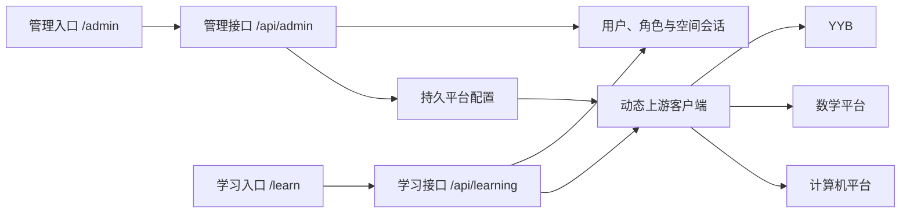

# 知序 Study · Web 学习系统

将数学与计算机小程序接入同一个 Web 学习空间，通过 YYB 获取微信登录 code，再分别建立两个平台的会话。题库、解析、课程与个人记录来自原平台。Web 直接呈现接口返回的内容，不叠加订阅、授权或额度判断。

项目包含 React / TypeScript 前端与 Node / Express 同源后端。支付、直播和客服不在迁移范围内。

## 启动

需要 Node.js 22.13+，建议使用 Node.js 24。SQLite 使用 Node 内置模块，无需额外数据库进程。

```sh
npm install
npm run dev
```

开发环境分别打开[管理空间](http://127.0.0.1:5173/admin/)和[学习空间](http://127.0.0.1:5173/learn/)。首次进入管理空间创建管理员，在“平台集成配置”中检查 YYB、数学与计算机设置，然后创建学习者并分配 YYB 账号。学习空间使用独立的登录会话；管理员如果需要学习，也在学习空间单独登录并使用分配给自己的账号。请先在本机完成初始化，再开放服务访问。

`.env.example` 中的 YYB、App ID、站点、租户、OAuth、OCR 和录播配置作为配置库首次创建时的初值。本机可读取未提交的 `yyb.txt` 和原小程序材料。此后由管理端维护持久配置；清空的秘密不会被环境变量或本机材料重新填回。秘密只在服务端保存，不使用 `VITE_*`，管理页面仅显示是否已配置。

```sh
npm run build
npm start
```

`npm run dev` 和 `npm start` 会读取存在的 `.env` 文件。

构建后分别打开[管理端成品](http://127.0.0.1:3001/admin/)和[学习端成品](http://127.0.0.1:3001/learn/)。根路径进入学习空间。后端同源提供两个独立前端入口及各自的请求命名空间。可通过反向代理提供 HTTPS；HTTPS 环境设置 `COOKIE_SECURE=1`，并保留原请求 Host，例如 Nginx 的 `proxy_set_header Host $http_host`，供同源校验使用。默认绑定本机地址，按部署环境设置 `HOST` 和 `PORT`。

## 使用

- 顶部切换“考研数学”和“计算机 408”，左侧进入题库、练习、测评、课程、错题、笔记、院校、社区和资料。
- 数学支持教辅/真题/书架、扫码与裁切搜题、结构化作答及完整解析、分类题库、专辑/模型/大计算训练、课程/模考/智能周测、教师阅卷、学习答疑和复习记录。
- 计算机支持五科章节/练习组/试卷、自选专业、简答与复试、答题卡/草稿/报告、解析/错题/收藏/笔记、课程、录播与弹幕、院校对比/目标、打卡和资讯。
- 原平台个人信息与历史学习统计在相应学科工作区中查看和管理。
- 学习概览、学习计划和 Web 学习报告记录本系统产生的学习活动，计划、目标与活动按 Web 用户保存在服务端，支持跨设备同步。浏览器保存待同步更改，网络恢复后重试；设置支持 JSON 备份导入/导出。
- 管理端 `/admin/` 提供总览、用户创建与停用、角色管理、YYB 账号分配、密码重置、公告、操作审计与运行诊断。平台配置可维护YYB地址/Key、两小程序App ID和平台地址、数学站点/登录/OCR、计算机租户/OAuth/录播密钥；可停用平台，并用真实账号检测登录与本人资料。学习者可以自行修改密码；管理员重置密码或停用用户会撤销现有登录。
- 两科做题区提供大屏题解对照、专注模式、16/18/20 字号和 `Alt + ← / →` 切题（输入时不触发）；考试解析仍受原流程约束。桌面导航可收起，计算机答题卡在大屏侧栏显示。
- 数学优先显示排版题干，整题截图按需展开；纯图片题与题干内图表仍直接显示。普通练习单选/判断点选即核对或保存，多选仍需提交；主观输入可用 `Ctrl / ⌘ + Enter` 提交。整卷保留草稿与交卷写入流程，已返回的答案和解析可直接查看，保存失败可重试。计算机解析使用知识点名称标签，原平台未提供的细分名称提示暂缺；题目视频在独立播放器区域呈现，返回播放地址即可使用，不再检查会员、试看次数或课程拥有状态。
- 视频提供倍速与浏览器支持时的画中画，HLS 播放依赖在需要时加载。
- 两个空间使用紧凑页头，学习概览直接呈现内容。用户、公告、审计、运行诊断及数学资料/题目目录/书架、两科课程、Web计划和学习足迹支持分页、总数、每页条数和跳页；筛选回到第一页，翻页后回到列表开头。管理用户、公告和审计由数据库按页查询。
- 已返回的课程、资料、解析、院校详情和下载内容直接可用；上游未返回数据或请求失败时如实呈现结果。无演示题库替代真实数据。

## 验证与迁移边界

```sh
npm run typecheck
npm test
npm run build
npm run verify:spaces
```

2026-10-29 当前版本完成管理与学习空间分离。类型、请求/权限/配置回归及生产构建通过；实际构建依赖图确认两个入口不互相加载业务模块。YYB现有账号已在新命名空间中完成两平台登录、读取和真实可逆写入；逐项结果以[真实接口记录](docs/live-api-checks.md)及[浏览器验收](docs/browser-acceptance.md)为准。真实业务失败或权限不足单列，不以测试替身宣称线上成功。

此前学习接口迁移验证：233项测试通过。真实账号已完成两平台资料、上传、权益、练习、周测、笔记、讨论、答疑及试听写入，并分别核对读回、清理和保留变化。[本轮真实写入验收](docs/live-write-acceptance.md)逐项记录成功、失败及缺业务前提，不能据此宣称所有线上接口均通过。

数学真题空列表已修复：原合并接口缺分类字段，现按原小程序独立试卷接口合并分类，当前可见186套真题、147份教辅；真实浏览器已打开2025年数一真题22题及解析。

更新后的 math 材料注册 216 个页面，其中 185 页有实际代码。课程47页、模考18页、答疑26页已按新版源码完成接口、操作与权限迁移；数学216页与计算机78页均已建立逐项映射。剩余 31 个空壳页面中有 19 页院校、11 页客服及 1 页微信独立授权。院校目录通过现有真实接口重新构建；客服不在迁移范围内，微信授权由 YYB 登录替代。

计算机章节分组、逐题保存、云端续学、交卷和AI评分已使用真实账号验证。收藏笔记仍被原服务4127拒绝、答案相似度返回业务500、数学OCR原证书过期；教师、课程、模考等缺对应角色/权益/窗口的操作单列。测试替身通过不代表未执行的生产写入已经通过。

详细事实与证据：

- [本轮真实写入总验收与平台保留变化](docs/live-write-acceptance.md)
- [数学源码审计](docs/math-audit.md)
- [计算机源码审计](docs/computer-audit.md)
- [认证与后端说明](docs/auth-audit.md)
- [真实 API 联调记录](docs/live-api-checks.md)
- [数学逐页覆盖](docs/math-implementation.md) · [计算机逐页覆盖](docs/computer-implementation.md)
- [浏览器验收](docs/browser-acceptance.md)

## 结构

```text
admin.html / src/admin-main.tsx   管理入口
learn.html / src/main.tsx         学习入口
src/apps/AdminApp.tsx             管理登录、独立导航与管理账号
src/App.tsx                      学习登录、导航、概览、计划与报告
src/pages/admin/                 平台集成配置与运行诊断
src/pages/AdminWorkspace.tsx      用户、公告、审计与总览
src/components/learning/          两学科共用学习工作台
src/platforms/                   两学科业务适配
src/lib/                         空间请求、身份与个人学习同步
shared/study-data.mjs             前后端共用学习记录校验
server/app.mjs                   应用装配、同源策略与入口分发
server/session-space.mjs         两空间独立认证
server/routes/admin.mjs           管理模块接口
server/routes/learning.mjs        个人学习模块接口
server/identity-store.mjs         用户、空间会话、学习记录、公告与审计
server/platform-config.mjs        版本化持久配置与秘密管理
server/upstream.mjs               根据运行配置访问YYB及两学科
server/runtime-insights.mjs       不收集正文及凭据的请求诊断
server/platform-policy.mjs        学习能力清单、本人约束与响应过滤
tests/                          自动化回归
```

## 空间、身份与运行配置



管理空间和学习空间分别构建，分别拥有导航、登录、会话与请求命名空间。`/api/admin/*` 只接受管理会话，`/api/learning/*` 只接受学习会话；cookie名称、Path与数据库会话space同时区分。退出其中一个空间不会退出另一个。学习空间中的管理员身份也只能访问本人分配账号，不提供全局目录或配置管理。

Web用户与YYB学习账号分开：前者表示系统成员，后者表示学习平台的账号身份。YYB账号唯一分配，学习请求中的本人身份由服务端约束。浏览器JSON和上传请求携带页面所属 `X-Study-User`，防止同一空间另一标签页换账号后，旧页面把内容提交给新用户。

默认身份库为 `.data/identity.sqlite`，配置库为同目录 `integrations.sqlite`，可通过 `STUDY_DATABASE_PATH`、`STUDY_CONFIG_DATABASE_PATH` 指定。密码使用随机盐scrypt，会话token只保存散列。配置库及WAL文件使用0600权限，秘密不返回浏览器、不写入审计或请求诊断。上游token只在服务端按Web用户保存在内存中。

持久配置是运行时唯一来源。保存使用revision检查防止覆盖其他管理者改动；YYB改动使两学科连接失效，单学科改动只使该学科失效。每次新的上游请求读取当前配置，一次登录握手使用同一配置快照。普通计算机请求使用配置的租户代码，图片答案相似度保留原平台要求的租户2。

学习计划、目标与活动按Web用户保存，同步使用revision，冲突后重读并重放待同步操作。前后端共享校验；浏览器缓存用于网络恢复后的重试。项目采用当前开发基线，入口与接口只保留上述两个空间，不提供旧版会话或记录迁移入口。

运行诊断展示当前进程最近100次请求的空间、接口模板、HTTP状态、耗时和请求编号，不采集请求正文、查询参数、cookie或token。响应 `X-Request-ID` 可与管理端诊断对应；配置变更、探测与用户管理另进入持久审计。

当前支持单Node进程、多用户及持久数据目录。重启保留Web登录、学习数据和管理配置，上游平台需要重新连接。备份时先停止服务，再复制整个数据目录。原小程序、`yyb.txt`、数据库、实测凭据与本机验收附件均被Git忽略。
