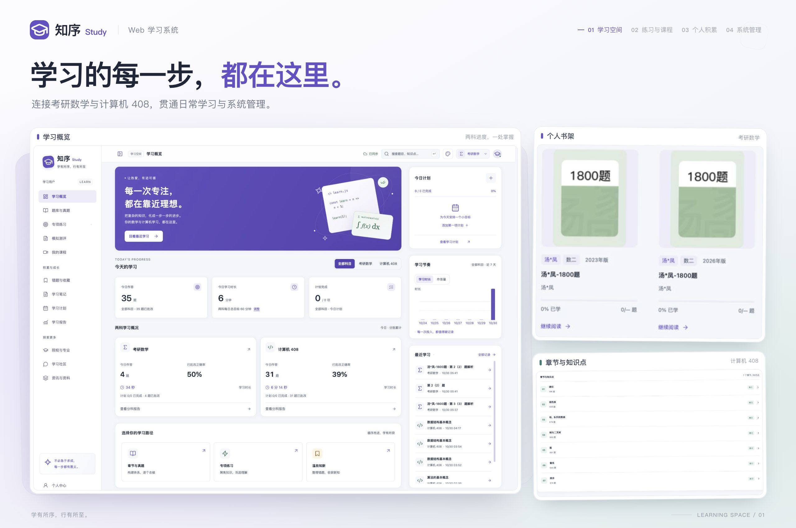
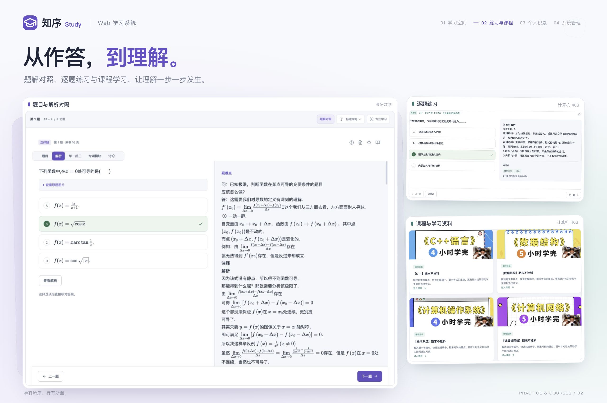
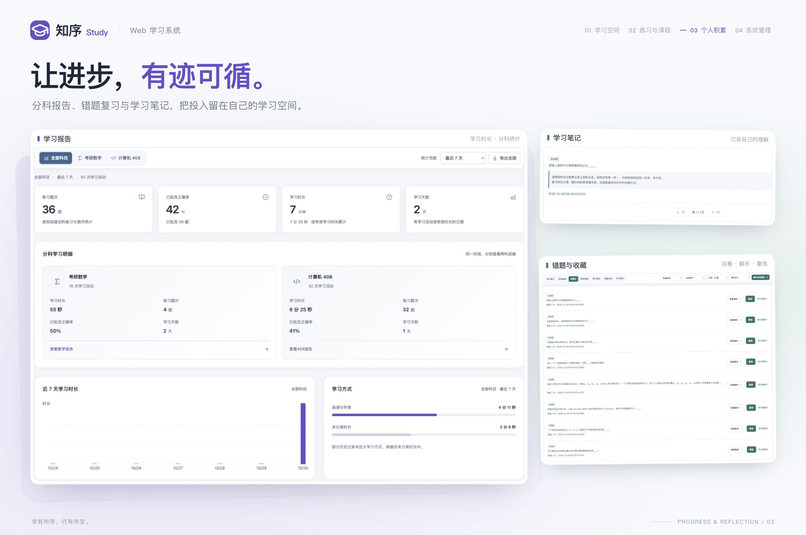
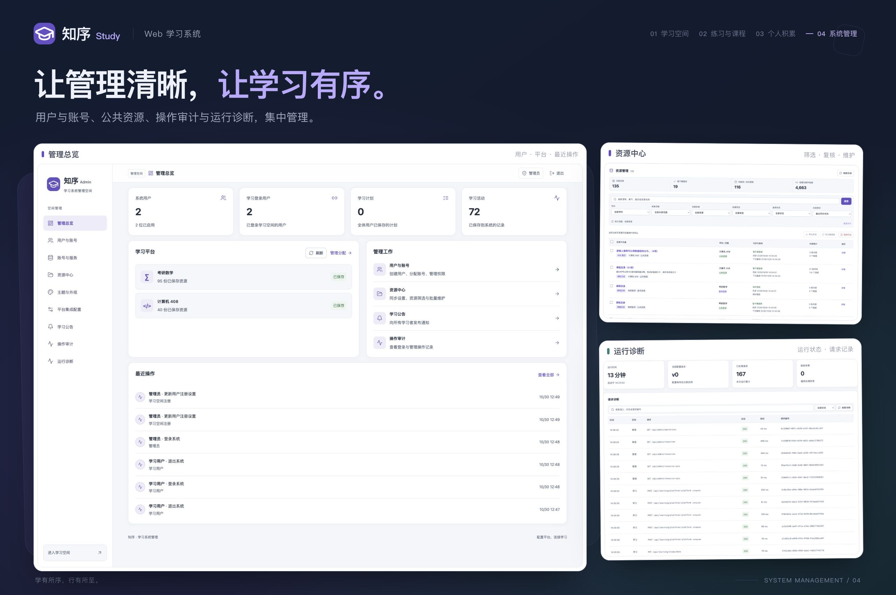

# 知序 Study · Web 学习系统

面向考研数学与计算机 408 的学习空间，将题库、解析、课程和测评放在一起，让练习、复习与学习规划相互衔接。用书架整理资料，用错题和笔记积累理解，用计划与报告记录每一步进步。

<table>
  <tr>
    <td width="50%"><a href=".github/readme/study-overview.jpg"></a></td>
    <td width="50%"><a href=".github/readme/study-practice.jpg"></a></td>
  </tr>
  <tr>
    <td width="50%"><a href=".github/readme/study-progress.jpg"></a></td>
    <td width="50%"><a href=".github/readme/study-admin.jpg"></a></td>
  </tr>
</table>

## 主要功能

| 空间 | 功能 |
| --- | --- |
| 考研数学 | 教辅与真题、个人书架、题目解析、专辑与模型训练、课程、测评、院校、答疑与资料 |
| 计算机 408 | 五科章节练习、专项与整卷练习、作答报告、课程录播、院校与社区 |
| 个人学习 | 学习计划、每日目标、分科报告、错题、收藏、笔记、历史记录与备份，跨设备继续学习 |
| 系统管理 | 用户与注册、学习账号分配、YYB 服务、平台设置、资源渐进式同步、公告、主题与运行诊断 |

## 快速开始

### 准备环境

- Node.js 24（最低 22.13，推荐版本见 [.node-version](.node-version)）
- PostgreSQL 14+，以及可用的数据库和连接账号

```sh
cp .env.example .env
# 编辑 .env，填写 DATABASE_URL 和 STUDY_SCHEMA_PREFIX
npm ci
npm run dev
```

启动后打开：

- [学习空间](http://127.0.0.1:5173/learn/)
- [管理空间](http://127.0.0.1:5173/admin/)

### 首次使用

1. 进入管理空间，创建管理员账号。
2. 在“平台集成配置”中填写并启用需要使用的学习平台，在“账号与服务”中添加 YYB 服务并选择可分配的账号。
3. 创建学习账号，或开启用户注册，然后登录学习空间开始学习。

平台参数也可通过 `.env` 配置；未由环境变量指定的项目可在管理端维护。填写方式见[环境变量示例](.env.example)和[系统配置](config/README.md)。

### 构建与部署

在当前机器运行生产版本：

```sh
npm run build
npm start
```

`npm start` 直接启动服务，需提前安装依赖。Linux/macOS 可使用 `npm run start:prod`：每次按 `package-lock.json` 重新安装生产依赖，成功后以 `NODE_ENV=production` 执行 `npm start`；安装失败则不启动。

默认提供 [学习空间](http://127.0.0.1:3001/learn/)和[管理空间](http://127.0.0.1:3001/admin/)。使用 HTTPS 时设置 `COOKIE_SECURE=1`，反向代理需保留原始 `Host`。端口及其他部署参数见[系统配置](config/README.md)。

部署到服务器前，执行：

```sh
npm run package:prod
```

命令会自动构建，再生成 `artifacts/releases/study-web-1.0.0.tar.gz`。文件名中的版本号来自 `package.json`，重复打包会更新同版本的压缩包。构建机需提供 `tar`，macOS 和 Linux 通常已自带。

压缩包包含 `dist/`、`server/`、`shared/`、`config/system.json`、依赖清单、`.env.example` 和 `.node-version`；不包含 `.env`、`node_modules/`、前端源码或测试文件。

服务器准备 Node.js 24、PostgreSQL 14+ 和可用数据库，上传压缩包后执行：

```sh
tar -xzf study-web-1.0.0.tar.gz
cd study-web
# 首次部署创建 .env；更新时保留已有配置
test -f .env || cp .env.example .env
# 编辑 .env，填写 DATABASE_URL、STUDY_SCHEMA_PREFIX 等配置
npm run start:prod
```

在宝塔 Node 项目管理器中，将项目目录设为解包后的 `study-web` 目录，选择 Node.js 24 和 `package.json` 中的 `start:prod` 命令启动。

安装依赖时需要连接 npm 仓库，运行账号需有项目目录的写权限。

数据库内容不包含在压缩包中。更新部署时保留服务器上的 `.env`，并继续连接需要使用的数据库。

## 资源更新与记录导入

### 渐进式更新学习资源

管理端“资源中心”可开启渐进式同步。资源随学习者访问逐步保存，已有公共资源可直接使用，缺失内容通过已配置的学习平台与 YYB 服务获取。

- 默认每 30 天建议复核一次，可在资源中心调整。开启同步时，到期资源仍可阅读，并在访问时尝试后台更新。
- YYB 暂不可用时，已保存的公共资源仍可使用。
- 关闭同步后停止自动保存和后台更新，已有资源与学习记录保留。
- 同步随实际访问进行，不会预先抓取全部内容或自动下载视频。
- 数学课程、题解及计算机课程优先使用已保存的播放地址，地址失效时才从对应来源更新并恢复播放。

### 导入已有学习记录

在个人中心关联自己的小程序账号，选择需要的书架、收藏、错题、笔记和历史记录，预览后导入。导入不会改动小程序中的原有记录，这里的新增与修改也不会同步回小程序。

## 开发与维护

```sh
npm run check              # 检查源码结构、类型、测试和构建依赖
npm run build              # 生成生产构建
npm run package:prod       # 自动构建并生成服务器部署包
npm run start:prod         # 重新安装生产依赖后启动服务
npm run verify:directories # 验证真实资源目录，需要有效的 YYB 配置
npm run clean              # 清理构建产物
npm run clean:reports      # 同时清理本机验收产物
```

自动化测试使用独立的临时数据空间，不访问真实 YYB 账号。真实接口验收、生成物管理和开发约定见[开发指南](CONTRIBUTING.md)。

| 文档 | 内容 |
| --- | --- |
| [系统配置](config/README.md) | 环境变量、平台设置、资源复核周期与主题配置 |
| [开发指南](CONTRIBUTING.md) | 开发流程、测试、真实接口验收与日常维护 |
| [代码架构](docs/architecture.md) | 源码组织与模块依赖 |
| [数据架构](docs/data-architecture.md) | 学习记录、公共资源与个人导入 |
| [多 YYB 服务](docs/multi-yyb-services.md) | 服务连接、账号池与账号分配 |
| [文档索引](docs/README.md) | 技术参考与历史记录 |
